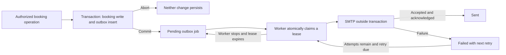

# Booking email notifications - Phase 1.2

## Initial audit

Read README.md, server/README.md, BOOKING_PHASE_1_1.md and MVP_MIGRATION.md before changing code. Inspected both existing email services, environment validation, booking/User/Vendor models, booking controllers and admin delegation, transaction guard, startup/index creation, frontend dashboard routes, backend tests and repository deployment configuration.

- Nodemailer is already installed. Password recovery/email-change and OTP have separate sender functions and test-only injection seams. They share SMTP environment conventions but differ in transport defaults and failure semantics. Keep these authentication services unchanged; reuse their configuration conventions, bounded SMTP timeouts and Planzo branding for a separate booking sender.
- Booking acceptance/availability already use a shared vendor transaction guard. Creation, rejection, cancellation and completion need ordinary transactions to atomically record email intent. Adding the vendor guard to cancellation would change coordination and deadlock the existing cancellation-wins rollback test; retain the original guard only where it is needed.
- The existing transition graph, participant authorization, HTTP 409 behavior, reservation index and response allowlists already work. Enqueue explicitly after successful writes, with the same session. Avoid model hooks that would email when test fixtures or historical scripts create records.
- Recipient routing must read User.email privately. Vendor contactDetails is an intentionally shared business contact, not the vendor owner's notification address. Never add emails to API population or copy whole documents into jobs.
- Cancellation has no existing product rule excluding the actor, so notify both customer and vendor. All messages use one recipient. Email bodies omit business/private contact fields and link to the existing /customer/dashboard or /vendor/dashboard; delayed acceptance email cannot reveal contacts after cancellation.
- A durable outbox and dispatcher do not exist. Use one MongoDB collection, a unique event/recipient identity, atomic claims, bounded retries and expiring token-fenced leases. SMTP cannot participate in a MongoDB transaction.
- The repository describes a persistent Node API (`node server.js`). No backend hosting-provider/cron manifest was found; frontend/vercel.json is only a frontend SPA fallback. Provide a separate Node worker and bounded `--once` mode compatible with a process supervisor or scheduled job. Do not start background email work by importing app.js.
- Existing endpoint booking tests already use replica sets. Auth-only tests seed bookings directly and can retain their standalone fixtures. All new automated email delivery must use mocks and fail closed in test mode.

## Scope and design decisions

Only Phase 1.2 is authorized. Preserve authentication, all booking status/business rules, reservation uniqueness, API contracts and frontend files. No new dependencies or external queue. No historical email backfill or real email sends during implementation/testing.

Each successful booking operation receives one UUID event identifier generated outside the retryable transaction callback. A unique eventId + recipientUserId index identifies one logical delivery; cancellation shares the event identifier across its two recipients. The identifier is not merely a status label. SMTP delivery happens only after commit in a separately executed worker.

## Implemented event flow

| Successful booking operation | Event | Recipient |
| --- | --- | --- |
| Create pending request | booking_requested | Vendor owner's account email |
| Accept pending request | booking_accepted | Customer |
| Reject pending request | booking_rejected | Customer |
| Cancel pending/accepted booking | booking_cancelled | Customer and vendor owner, including a participant actor |
| Complete accepted booking | booking_completed | Customer |

Both admin status routes use the same implementation. Admin actors are not additional recipients. No product rule excludes a cancelling customer, so both participants are notified. No jobs are created for unauthorized, invalid, stale, repeated or reservation-conflicting operations. Direct model writes/backfills do not emit email events.



Creation and reject/cancel/complete now use the same shared transaction wrapper, without taking the vendor guard. Acceptance retains the Phase 1.1 vendor guard and availability checks. All notification recipient reads/inserts receive the booking's MongoDB session. Insertion failure aborts the booking mutation rather than silently losing intent; SMTP failure happens later and only changes outbox delivery state. A new booking ObjectId and each operation's event UUID are allocated outside retry callbacks, so retries preserve one booking/event identity.

## Outbox and dispatcher

The internal notificationoutboxes collection stores bookingId, eventId, eventType, recipientUserId, recipientEmail snapshot, an explicit payload snapshot, status, attempts, nextAttemptAt, createdAt/updatedAt, sentAt, lastError, leaseToken and leaseExpiresAt. There is no public outbox API. Payload fields are limited to customer/business names, service, event type, calendar day, event location and recipient role. Description, notes, rejection/cancellation reasons, passwords, tokens, account contacts and vendor sharing contacts are never copied into the payload.

Indexes are additive:

```javascript
// Startup creates/waits for these; these examples were not applied to production.
db.notificationoutboxes.createIndex(
  { eventId: 1, recipientUserId: 1 },
  { name: "one_booking_email_per_event_recipient", unique: true }
)
db.notificationoutboxes.createIndex({ status: 1, nextAttemptAt: 1, createdAt: 1 })
db.notificationoutboxes.createIndex({ status: 1, leaseExpiresAt: 1 })
```

Cancellation jobs share an event UUID but have distinct recipient user IDs. Unrelated changes have different UUIDs even if their status labels match. If corrupt legacy data has lost a recipient or usable email, the booking action still succeeds and records a terminal failed intent with the known user ID (or null if the vendor reference itself is gone), an empty email snapshot and a fixed unavailable-recipient error. It does not silently route to a business contact or make an existing booking impossible to manage.

Dispatcher policy is deliberately small and fixed in bookingEmailDispatcher.js:

| Setting | Value |
| --- | --- |
| Worker poll interval | 5 seconds |
| Serial batch size | At most 25 jobs |
| Maximum claim attempts | 5 |
| Processing lease | 120 seconds |
| SMTP connection / greeting / inactivity timeout | 10 / 10 / 15 seconds |
| Sender total deadline | 35 seconds; destroys the owned socket |
| Outer delivery budget | 45 seconds, checked against remaining lease time |
| Retry delay | 30 seconds x 2^(attempts - 1), capped at 1 hour |
| Worker database operation / majority acknowledgement timeout | 10 seconds |

At the default five attempts, retry delays are 30, 60, 120 and 240 seconds. Each claim, including a recovered crash, consumes an attempt. Failed jobs with a nextAttemptAt are retryable; failed jobs with null nextAttemptAt are terminal. Expired processing jobs below the limit can be reclaimed. Expired final-attempt jobs become terminal failed rather than remaining processing forever.

Claims atomically change one due pending/failed job or an expired processing job to processing, assign a fresh lease UUID, and increment attempts. Writes use majority acknowledgement. Before sending, a primary-only read verifies the current token and enough lease time, then the worker rechecks the clock after that read. Success/failure acknowledgements require the same token, processing state and unexpired lease. A stale worker cannot overwrite a newer claim. Database acknowledgement errors leave recovery to the durable lease instead of immediately resending.

Nodemailer's ordinary nonpooled transport.close() does not abort its active send. The booking sender therefore uses its documented getSocket hook to own the underlying TCP connection, abort/destroy it at the total deadline, and prevent late callbacks from resuming delivery. Nodemailer still performs certificate validation, implicit TLS and STARTTLS. This behavior is tested with the installed Nodemailer and a loopback fake SMTP server; no external email provider is used in tests.

The sender verifies a single accepted recipient and treats resolved rejection/missing acceptance as failure. A stable SHA-256 Message-ID derived from event ID and recipient ID is reused across retries. Failure categories are fixed/allowlisted; raw provider messages, SMTP replies, addresses, credentials and exception stacks are never written to lastError or worker logs.

## Templates and privacy

Each message has a Planzo-branded responsive HTML body and a plain-text alternative, static subject, booking reference, recorded status, event day/service/details and a useful dashboard link. All dynamic HTML values are escaped. Event dates render as literal validated YYYY-MM-DD calendar days, without timezone conversion. Links are built from the first validated CLIENT_URL origin and the recipient's existing dashboard route; payload data cannot override the destination. Production requires HTTPS.

Messages go to one private account-address snapshot without CC/BCC or the other participant's account contact. Even acceptance messages omit vendor business contacts: the authorized dashboard retains the existing accepted/completed contact-sharing rules. This also prevents a delayed accepted notification from disclosing contacts after a cancellation. The footer explains that the email records a past change and the dashboard shows the latest status.

## Worker execution and deployment

Run from server/ with the same environment used by the API:

```sh
# API process (as before)
npm start

# Separate persistent worker process
npm run email:worker

# Alternative: one scheduled batch, then exit
npm run email:worker -- --once
```

Use an existing process supervisor or the host's separate Node worker capability with automatic restart. The repository does not identify a backend hosting provider, so no provider-specific infrastructure was invented. The API and worker are independent processes; do not attach delivery to an HTTP response's lifetime. If the host cannot run persistent workers, schedule --once with the same database and environment. Each invocation claims at most 25 serial jobs; allow for up to 35 seconds per SMTP attempt plus database work, rather than a short serverless request timeout. Overlapping invocations are safe through atomic leases, but a persistent worker is the simplest deployment for the documented long-running Node architecture.

SIGINT/SIGTERM stop new claims, interrupt polling and allow the in-flight attempt/acknowledgement to finish. A 55-second shutdown deadline forces exit if necessary; abandoned claims recover after lease expiry. Stopping/restarting workers does not erase jobs. Keep worker host clocks synchronized because lease comparisons use UTC wall-clock times. The CLI deliberately refuses NODE_ENV=test before connecting to a database; service-level tests inject the provider.

Rollout procedure:

1. Retain all Phase 1.1 replica-set/date/index requirements. Back up and validate this release on staging.
2. Review the new collection/index names above; give API and worker access to the outbox and index creation. Keep the existing reservation index unchanged. Do not run syncIndexes or drop legacy collections.
3. Configure the existing SMTP variables and first frontend origin for the deployed site. Ensure the worker host can reach MongoDB and the SMTP port. SMTP credentials are validated before jobs are claimed, though that preflight does not verify provider connectivity/credentials remotely.
4. Deploy the new API instances, which wait for the outbox indexes before listening, and start the separate worker. Coordinate/pause booking mutations during a mixed-version cutover if notifications must cover every cutover event: old API code does not enqueue. Historical bookings are not emailed automatically.
5. Monitor queued age and terminal failures below. Check actual provider delivery with an operator-controlled staging workflow before enabling real customer traffic. No production database, worker or email send was started by this implementation.
6. For rollback, stop dispatch separately; reverting API source does not remove committed jobs. Preserve the outbox until retention/replay decisions are reviewed.

## Environment variables

No new secrets or required configuration variables were introduced. The worker reuses the existing validateEnvironment() and SMTP conventions; use the same server environment, including existing authentication configuration required by that shared validator. Authentication itself is unchanged.

| Variable | Requirement |
| --- | --- |
| NODE_ENV | production for deployment; the CLI refuses test |
| MONGODB_URI | Existing MongoDB 6+ replica-set/mongos connection to the same database as the API |
| CLIENT_URL | First frontend origin supplies email links; required HTTPS origin in production; localhost:5173 default in development |
| SMTP_HOST | SMTP hostname |
| SMTP_PORT | Booking/account sender defaults to 587; use provider's configured port, for example 465 with immediate TLS |
| SMTP_SECURE | Existing true/false setting; port 465 uses immediate TLS |
| SMTP_USER | Existing SMTP username; production validation requires credentials |
| SMTP_APP_PASSWORD | Preferred existing SMTP secret; SMTP_PASS remains its legacy fallback |
| SMTP_FROM_EMAIL | Sender address; legacy SMTP_FROM display-name/address is supported instead |
| SMTP_FROM_NAME | Optional, defaults to Planzo when SMTP_FROM_EMAIL is used |
| JWT_SECRET | Existing API secret, at least 32 characters; required by reused environment validation, not embedded in email |
| OTP_HMAC_SECRET | Existing production OTP secret, at least 32 characters; required by reused environment validation, not used for booking delivery |

Existing optional Cloudinary/auth settings remain validated as before. Runtime retry/lease policy constants are not another required set of environment variables. The sender uses the account-mail port convention without altering the OTP service's existing defaults.

## Monitoring and terminal failures

Read-only MongoDB examples avoid printing private recipient addresses or message content:

```javascript
db.notificationoutboxes.aggregate([
  { $group: { _id: "$status", count: { $sum: 1 } } }
])
db.notificationoutboxes.find(
  { status: { $in: ["pending", "failed"] }, nextAttemptAt: { $ne: null } },
  { bookingId: 1, eventType: 1, createdAt: 1, attempts: 1, nextAttemptAt: 1 }
).sort({ createdAt: 1 }).limit(10)
db.notificationoutboxes.find(
  { status: "failed", nextAttemptAt: null },
  { bookingId: 1, eventType: 1, attempts: 1, lastError: 1, createdAt: 1 }
).sort({ createdAt: -1 }).limit(20)
```

Alert on an old ready backlog, expired processing leases, terminal failures, or a stopped worker. Logs contain batch counts and sanitized categories only. A successful --once exit means the batch ran, not that every message was delivered: SMTP failures persist as retryable/terminal job states. Investigate configuration/provider problems before an operator-approved replay of terminal jobs. Preserve event/recipient identity and Message-ID when replaying; do not replay by changing booking status or creating a new booking. No automatic terminal-job replay or cleanup script is included.

## Files changed

| File | Purpose |
| --- | --- |
| [server/src/models/NotificationOutbox.js](../server/src/models/NotificationOutbox.js) (new) | Durable internal job schema and indexes |
| [server/src/services/bookingNotificationService.js](../server/src/services/bookingNotificationService.js) (new) | Same-session recipient snapshots and event inserts |
| [server/src/services/bookingEmailService.js](../server/src/services/bookingEmailService.js) (new) | Templates, existing SMTP config, private delivery and real socket cancellation |
| [server/src/services/bookingEmailDispatcher.js](../server/src/services/bookingEmailDispatcher.js) (new) | Atomic claims, leases, retries, fencing and sanitized failures |
| [server/scripts/dispatchBookingEmails.js](../server/scripts/dispatchBookingEmails.js) (new) | Persistent/scheduled worker lifecycle |
| [server/src/controllers/bookingController.js](../server/src/controllers/bookingController.js) | Enqueue inside successful booking transactions |
| [server/src/utils/vendorBookingTransaction.js](../server/src/utils/vendorBookingTransaction.js) | Reusable ordinary transaction wrapper; existing vendor guard retained |
| [server/server.js](../server/server.js) | Await outbox indexes before listening |
| [server/package.json](../server/package.json) | Worker execution command, no dependency changes |
| [server/test/bookingNotifications.test.js](../server/test/bookingNotifications.test.js) (new) | Transactional integration and recipient/privacy tests |
| [server/test/bookingEmailDispatcher.test.js](../server/test/bookingEmailDispatcher.test.js) (new) | Dispatch/retry/restart/concurrency tests |
| [server/test/bookingEmailTemplates.test.js](../server/test/bookingEmailTemplates.test.js) (new) | Template, SMTP and actual socket/TLS cancellation tests |
| [server/test/bookingReliability.test.js](../server/test/bookingReliability.test.js) | Initialize the new indexed test collection |
| [server/test/mvpMarketplace.test.js](../server/test/mvpMarketplace.test.js) | Initialize/clean the new test collection |
| [server/.env.example](../server/.env.example) | Existing configuration reuse notes |
| [server/README.md](../server/README.md) | API event and worker documentation |
| [README.md](../README.md) | Worker setup and deployment |
| [docs/MVP_MIGRATION.md](MVP_MIGRATION.md) | Additive outbox rollout and rollback guidance |
| [docs/BOOKING_PHASE_1_2.md](BOOKING_PHASE_1_2.md) (new) | Initial audit and implementation report |

No authentication modules, Booking/User models, reservation index, dependencies, frontend files or existing test assertions were removed or rewritten.

## Validation

| Command/check | Result |
| --- | --- |
| Existing booking regression `npm.cmd test -- test/mvpMarketplace.test.js test/bookingReliability.test.js` | 23 passed |
| `npm.cmd test -- test/bookingNotifications.test.js` | 15 passed |
| `npm.cmd test -- test/bookingEmailDispatcher.test.js` | 10 passed |
| `npm.cmd test -- test/bookingEmailTemplates.test.js` | 14 passed |
| Complete backend regression `npm.cmd test` | **110 passed, 0 failed, 0 skipped**, approximately 96.4 seconds |
| `npm.cmd run check` | All 54 JavaScript files passed syntax checks |
| `git diff --check` | Passed |

The 39 new top-level tests cover every requested proof: all five event mappings, both cancellation recipients/actors/admin routes, invalid/unauthorized/conflicting/repeated operations, before-commit invisibility, rollback of booking/jobs/guard, SMTP-independent booking state, retry/backoff/max attempts, restart and final-attempt lease recovery, concurrent claims and stale acknowledgements, contact privacy, calendar rendering, HTML escaping, installed logical-identity index, retry-stable UUIDs, and missing legacy recipients. Tests also prove that a timed-out installed Nodemailer connection is actually destroyed and implicit TLS/STARTTLS remain enabled.

No real emails were sent. Provider calls were mocked; the additional transport regressions use only a local fake SMTP server that never receives DATA or delivers mail. The standalone worker refuses test mode. Existing authentication email mocks and tests remain intact. Known MongoMemoryServer ECONNRESET teardown diagnostics appeared on Windows but all assertions/processes passed. No frontend tests were needed because no frontend files or contracts changed.

## Remaining risks and limits

- SMTP acceptance and marking a job sent cannot be atomic. A process crash, ambiguous SMTP timeout, or lost database acknowledgement after acceptance can cause another delivery after lease recovery. Stable Message-ID, exclusive claims, token fencing and real socket cancellation reduce avoidable duplicates but cannot guarantee mailbox deduplication or exactly-once delivery. Sent means SMTP accepted, not guaranteed inbox arrival; bounce/webhook tracking is outside this phase.
- Retries are bounded. Terminal failures require operator investigation/replay; this is durable intent with best-effort retry, not an unlimited eventual-delivery guarantee. No monitoring service or host process supervisor was configured remotely.
- The recorded status/email address are event snapshots. Retries or multiple workers may deliver events out of order, and an address changed later is not substituted. The dashboard link gives the latest state; no contacts are included in delayed messages. Repeated POST creation remains the existing behavior: two successful new booking requests produce two legitimate request events. Status repeats still return 409 and enqueue nothing.
- Workers need synchronized clocks, SMTP egress and sufficient process/scheduler lifetime. Production SMTP reputation, TLS/provider credentials, hosting limits, failover and load were not exercised. Multi-worker contention is tested against real MongoDB fixtures; cross-host faults are not simulated.
- The outbox retains recipient addresses and event location/name snapshots internally. Restrict database access/backups and choose an appropriate retention policy. No automatic TTL deletes pending/failed evidence. Queue growth during an outage is durable and needs capacity/age monitoring.
- Existing Phase 1.1 limitations, including the broader account-deactivation race and UTC/local-calendar UI boundary, are unchanged. Orphaned recipient records remain terminal failed rather than being silently rerouted.

## Sources and Community Wisdom

The implementation follows MongoDB's [same-session transaction/retry guidance](https://www.mongodb.com/docs/drivers/node/current/crud/transactions/) and Nodemailer's [SMTP transport options](https://nodemailer.com/smtp) and [documented custom-socket hook](https://nodemailer.com/smtp/proxies). The [transactional outbox pattern description](https://microservices.io/patterns/data/transactional-outbox) explicitly identifies the publish-before-acknowledgement duplicate window; bounded email retries here do not promise its unlimited-delivery assumptions.

### 🌐 Community Wisdom: [Transactional Outbox pattern step by step with Spring and Kotlin](https://dev.to/aleksk1ng/transactional-outbox-pattern-step-by-step-with-spring-and-kotlin-3gkd)
> **Source**: [Alexander](https://dev.to/aleksk1ng)
> **Tags**: `java`, `kotlin`, `microservices`, `spring`
>
> The author's working implementation separates atomic intent storage from polling delivery and highlights duplicate handling and event-ordering limits. Its single comment was an acknowledgement, with no substantive counterargument; this is implementation evidence, not broad community consensus. Planzo reuses the principle with MongoDB and its existing SMTP stack, without adding the article's broker infrastructure. The DevRelay gateway was unavailable, so public articles and primary documentation were read directly.
>
> 🔗 [Read Full Discussion](https://dev.to/aleksk1ng/transactional-outbox-pattern-step-by-step-with-spring-and-kotlin-3gkd)

A DEV draft or shared session transcript can be prepared separately if requested; neither was created or published. Phase 1.2 ends here.
