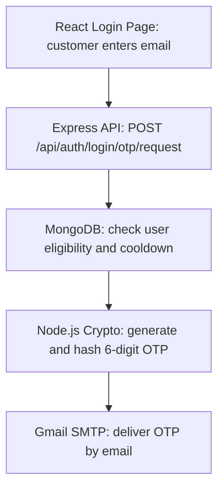
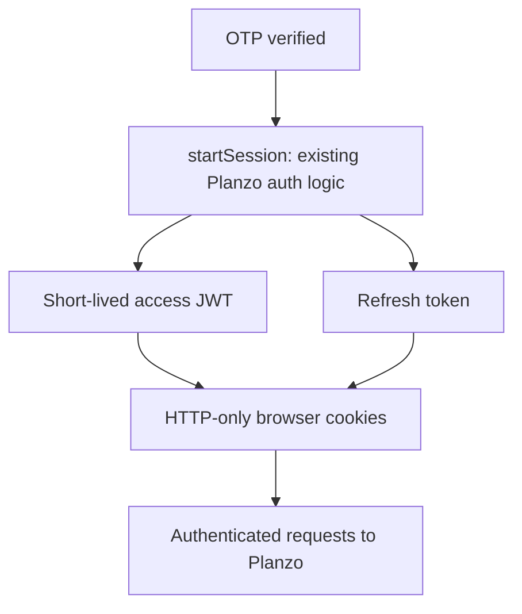

# Planzo Email OTP Authentication — Backend Explained

> A step-by-step explanation of Planzo’s existing Email OTP login flow, including Express, MongoDB, Node.js Crypto, Gmail SMTP, and JWT cookies. Code snippets below are simplified teaching examples, not a verbatim export of the repository.

I'll explain how Planzo's Email OTP authentication backend works internally, step by step, using the controller functions, MongoDB queries, JWT logic, and Gmail SMTP integration from the implementation you shared.

**Core flow:** User enters email → Backend generates OTP → Gmail SMTP sends email → Backend verifies OTP → JWT session is created → User is logged in.

## 1. Backend files and their responsibilities

Your implementation is organized around these files:

| File                 | Responsibility                        |
| -------------------- | ------------------------------------- |
| `authRoutes.js`      | Defines authentication API endpoints  |
| `authController.js`  | Handles OTP requests and verification |
| `EmailOtp.js`        | Stores OTP records in MongoDB         |
| `otpEmailService.js` | Sends OTP emails through Gmail SMTP  |
| `User.js`            | Stores customers, vendors, and admins |
| `environment.js`     | Loads and validates configuration     |

There are two important functions inside `authController.js`:

- `requestLoginOtp()` — creates and sends the OTP.
- `verifyLoginOtp()` — checks the OTP and logs in the user.

## 2. Part One — How the backend sends an OTP



### Step 1: React sends the email to Express

Suppose a customer enters:

```text
customer@gmail.com
```

The frontend makes this API request:

```javascript
const response = await axios.post(
  "/api/auth/login/otp/request",
  {
    email: "customer@gmail.com"
  }
);
```

Express receives the request and runs the `requestLoginOtp` controller.

### Step 2: Backend checks MongoDB for the user

Your backend uses a Mongoose query like:

```javascript
const user = await User.findOne({
  email,
  accountStatus: { $ne: "deactivated" },
  suspendedAt: null,
});
```

Let's understand the query:

- `email` — find the account with the supplied email.
- `$ne: "deactivated"` — exclude deactivated accounts.
- `suspendedAt: null` — exclude accounts marked as suspended.

The surrounding controller logic also needs to confirm that the account's role is `customer` or `vendor`.

If no eligible account exists, the backend returns a generic success message without sending an OTP. This prevents someone from using the endpoint to discover registered accounts.

### Step 3: Backend generates the OTP

Your code uses Node.js's built-in `crypto` module:

```javascript
import crypto from "node:crypto";

const otp = crypto.randomInt(100000, 1000000);
```

For example:

```text
OTP = 482913
```

Why use `crypto.randomInt()`?

Because it provides cryptographically secure random numbers, unlike ordinary `Math.random()`.

### Step 4: Backend hashes the OTP

You should never store the actual OTP directly in MongoDB.

Your code uses:

```javascript
const hash = crypto
  .createHmac("sha256", process.env.OTP_HMAC_SECRET)
  .update(String(otp))
  .digest("hex");
```

For example:

**Hashing example:**

```text
Original OTP sent to customer: 482913
                    |
         HMAC-SHA256 + secret
                    |
MongoDB stores: hexadecimal hash (not the code)
```

Why hash it?

Even if someone gains read access to the OTP collection, they cannot simply see the six-digit codes. The separate HMAC secret protects the low-entropy OTP values from straightforward offline guessing.

### Step 5: Backend saves OTP in MongoDB

Your `EmailOtp` document might look like:

```javascript
{
  email: "customer@gmail.com",
  codeHash: "generated-hmac-hash",
  expiresAt: new Date(Date.now() + 5 * 60 * 1000),
  requestedAt: new Date(),
  attempts: 0,
  consumedAt: null
}
```

Explanation:

| Field         | Meaning                         |
| ------------- | ------------------------------- |
| `email`       | Which account requested the OTP |
| `codeHash`    | Hashed six-digit code           |
| `expiresAt`   | When OTP becomes invalid        |
| `requestedAt` | When OTP was requested          |
| `attempts`    | Number of incorrect attempts    |
| `consumedAt`  | Whether OTP was already used    |

The OTP is valid for five minutes.

### Step 6: Backend sends through Gmail SMTP

The `otpEmailService.js` file communicates with Gmail SMTP through Nodemailer.

A simplified example:

```javascript
import nodemailer from "nodemailer";

const transporter = nodemailer.createTransport({
  host: process.env.SMTP_HOST,
  port: Number(process.env.SMTP_PORT || 465),
  secure: true,
  auth: {
    user: process.env.SMTP_USER,
    pass: process.env.SMTP_APP_PASSWORD,
  },
});

await transporter.sendMail({
  from: { name: "Planzo", address: process.env.SMTP_FROM_EMAIL },
  to: user.email,
  subject: "Your Planzo Verification Code",
  text: `Your verification code is ${otp}. It expires in 5 minutes.`,
});
```

Use a Google App Password rather than the normal Gmail account password. The backend submits the message through Gmail SMTP and does not expose SMTP credentials to the frontend.

Because you don't currently own a sending domain, you can use a Gmail account with a Google App Password. The sender address should be the configured Gmail account.

If Gmail SMTP submission fails, your controller returns `503 Service Unavailable`.

## 3. Part Two — How the backend verifies an OTP

When the customer receives the OTP and enters it, the frontend sends another API request.

```javascript
await axios.post(
  "/api/auth/login/otp/verify",
  {
    email: "customer@gmail.com",
    code: "482913"
  }
);
```

Notice that your backend expects the field `code`, not `otp`.

### Step 1: Backend searches for the OTP record

Conceptually, your verification controller looks up an active challenge for the email.

```javascript
const otpRecord = await EmailOtp.findOne({
  email,
  consumedAt: null
});
```

It then checks:

- Does a valid OTP record exist?
- Has it expired?
- Has it already been used?
- Has the user exceeded the attempt limit?

### Step 2: Backend hashes the entered code

Suppose the customer enters:

```text
482913
```

The backend hashes that input using the same secret:

```javascript
const submittedHash = crypto
  .createHmac("sha256", process.env.OTP_HMAC_SECRET)
  .update(code)
  .digest("hex");
```

It compares the submitted hash with the stored hash.

| Comparison | Result |
| --- | --- |
| Stored hash matches submitted OTP hash | Continue verification and login |
| Hashes do not match | Reject and increase the failed-attempt counter |

In production, the comparison should be performed securely, such as with `crypto.timingSafeEqual()` for equal-length hashes.

### Step 3: Backend marks OTP as used

After successful validation, it updates the MongoDB record:

```javascript
{
  consumedAt: new Date()
}
```

The conditional database update uses `consumedAt: null` to ensure the same OTP cannot be redeemed again.

This is called single-use authentication.

### Step 4: Backend retrieves the user role

Your backend queries the user again:

```javascript
const user = await User.findOne({
  email,
  accountStatus: { $ne: "deactivated" },
  suspendedAt: null,
  role: { $in: ["customer", "vendor"] }
});
```

This is important because the customer cannot become an admin by changing the role in a frontend request.

The database determines the real role.

## 4. Part Three — How JWT login happens

This is where Planzo's existing authentication system becomes useful.

After OTP verification, your backend calls:

```javascript
await startSession(
  res,
  user,
  200,
  "Logged in successfully."
);
```

The shared `startSession()` function performs the normal authentication process.



When the customer later opens their dashboard, the browser sends the relevant cookies to your backend.

Your authentication middleware validates the session, determines the authenticated user, and allows or rejects access to protected API routes.

**Important:** The frontend doesn't need to read the JWT from JavaScript. HTTP-only cookies protect the token from direct JavaScript access. Your API client must still send credentials correctly when required.

## 5. What happens when the user refreshes the page?

You previously saw:

```text
GET /api/auth/refresh 401 Unauthorized
```

Here's the difference:

**Before login:** The browser doesn't have valid authentication cookies, so the backend rejects refresh with `401`. This is normally expected.

**After login:** The browser has valid cookies. When the access token expires, the frontend can call `/api/auth/refresh` to obtain a new authenticated session without asking for another OTP, provided the refresh session remains valid.

**Takeaway:** OTP establishes the login session; it is not required on every page refresh.

## 6. Complete backend example

This is simplified pseudocode representing your two controllers, not an exact copy of your source file.

```javascript
// CONTROLLER 1: REQUEST OTP

async function requestLoginOtp(req, res) {
  const email = normalizeEmail(req.body.email);

  // Validate email and enforce cooldown/rate limits
  await enforceOtpLimits(email, req);

  // Find eligible customer/vendor
  const user = await findEligibleUser(email);

  if (!user) {
    return res.json({
      success: true,
      message: "If an eligible account exists, a code has been sent."
    });
  }

  // Generate OTP
  const otp = generateSecureOTP();

  // Hash and store OTP with expiry
  await saveOtpChallenge(email, hashOTP(otp));

  // Send through Gmail SMTP
  await sendLoginOtp(email, otp);

  return res.json({
    success: true,
    message: "If an eligible account exists, a code has been sent."
  });
}


// CONTROLLER 2: VERIFY OTP

async function verifyLoginOtp(req, res) {
  const { email, code } = req.body;

  // Find OTP record
  const record = await findActiveOtp(email);

  // Validate expiry, attempts, and code
  await validateOtp(record, code);

  // Fetch eligible user
  const user = await findEligibleUser(email);

  // Atomically consume OTP
  await consumeOtp(record);

  // Create JWT cookies and session
  return startSession(
    res,
    user,
    200,
    "Logged in successfully."
  );
}
```

Your real controllers must also preserve the existing validation, rate limiting, delivery-failure handling, and atomic updates. These helper functions illustrate the logic rather than providing a drop-in implementation.

## 7. Important security point to verify

One detail in the code description deserves attention: the OTP login lookup checks the email, account status, suspension status, and role, but the shown query does not include an `emailVerified` check.

If Planzo previously allowed registration using an email address without verifying ownership, allowing immediate OTP login to that account could introduce an account takeover risk.

Before enabling email OTP for every existing account, verify how email ownership is established in your existing registration system and handle legacy unverified accounts safely.

## 8. What you should understand from this implementation

- MongoDB stores account details and temporary OTP verification records.
- Node.js Crypto generates the OTP and hashes it securely.
- Gmail SMTP delivers the OTP email.
- Express controllers apply the authentication rules.
- JWT maintains the logged-in session after verification.
- React displays the OTP interface and redirects users according to their authenticated role.

**Key architectural idea:** Email OTP is just another way to prove identity. Once identity is verified, both OTP login and password login call the same existing session system.

That's why you can add Email OTP to Planzo without changing the booking, vendor dashboard, or customer dashboard authentication architecture.
